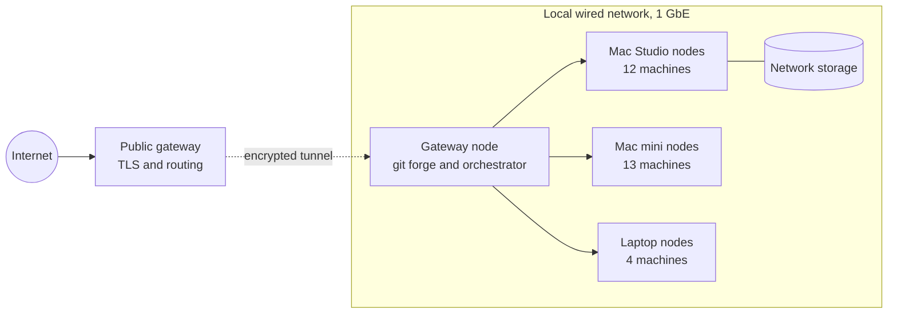

  

**Professor · Department of Administrative Sciences · Université du Québec en Outaouais (UQO)** 
Gatineau, Québec, Canada · Pavillon Alexandre-Taché · bilingual, French and English

<b>Table of contents</b>

- [About](#about)
- [At a glance](#at-a-glance)
- [Live from the forge](#live-from-the-forge)
- [Research](#research)
  - [Peer-reviewed publication](#peer-reviewed-publication)
  - [Doctoral thesis](#doctoral-thesis)
  - [UQO Working Paper Series](#uqo-working-paper-series)
  - [How a paper is quality-controlled](#how-a-paper-is-quality-controlled)
  - [Books](#books)
  - [Earlier papers and conferences](#earlier-papers-and-conferences)
- [Native Apple apps](#native-apple-apps)
- [Web platforms and AI tooling](#web-platforms-and-ai-tooling)
- [MacLustr, the compute cluster](#maclustr-the-compute-cluster)
- [Teaching](#teaching)
- [Education and positions](#education-and-positions)
- [Toolbox](#toolbox)
- [Get in touch](#get-in-touch)

## About

I am a financial econometrics researcher and a macOS / AI developer. I am a professor in the Department of Administrative Sciences at UQO, where I teach real-estate valuation, and I am completing a Ph.D. in Business Administration (Finance and Insurance) at Université Laval under the supervision of Prof. Marie-Hélène Gagnon and Prof. Gabriel J. Power.

My research covers financial econometrics, high-frequency finance, volatility modelling, commodity and energy markets, monetary policy announcements, textual analysis, real-estate valuation and housing markets, and applied AI: language models, autonomous agents and machine learning on Apple Silicon.

I also build software in my spare time: native macOS and iOS apps, web data platforms and research infrastructure. All of it runs on a personal Apple Silicon compute cluster and is published on my own git forge. Everything I publish is free, and every working paper ships with its code.

| | |
|:--|:--|
| **Now** | Working on high-frequency finance, and finishing the doctoral thesis |
| **Research** | 31 quality-controlled working papers, one peer-reviewed article, two books |
| **Teaching** | Real-estate valuation at UQO, finance and econometrics at Université Laval |
| **Building** | The ORIX family of native Apple apps, VQuant, and the MacLustr cluster |
| **Based in** | Gatineau, Québec, Canada |

> [!NOTE]
> **GitHub is a mirror.** My work lives on my own forge, [git.spboucher.ai](https://git.spboucher.ai). The repositories here are read-only second copies of a selection of them. Issues and history of record are on the forge.

## At a glance

**Research**

**Software**

**Infrastructure**

## Live from the forge

These badges are rendered by [git.spboucher.ai](https://git.spboucher.ai) itself, so they stay current without any action on this page.

**Repositories by primary language**

| Language | Repositories | Share |
|:--|--:|:--|
| Python | 62 | `███████████` 27% |
| Swift | 54 | `█████████` 23% |
| TypeScript | 48 | `████████` 21% |
| TeX | 33 | `██████` 14% |
| JavaScript | 16 | `███` 7% |
| HTML | 15 | `███` 6% |
| C++ | 2 | `▏` 1% |

**Activity on selected projects**

| Project | What it is | Activity, last 26 weeks | Commits | Last commit |
|:--|:--|:--|:--|:--|
| [**spboucher.ai**](https://git.spboucher.ai/spboucher.ai) | Personal website |  |  |  |
| [**vquant**](https://git.spboucher.ai/vquant) | Financial intelligence platform |  |  |  |
| [**sp-wallet**](https://git.spboucher.ai/sp-wallet) | Multi-network wallet |  |  |  |
| [**sp-mail**](https://git.spboucher.ai/sp-mail) | Self-hosted mail |  |  |  |
| [**orix-sheet**](https://git.spboucher.ai/orix-sheet) | Native Mac spreadsheet |  |  |  |
| [**orix-docs**](https://git.spboucher.ai/orix-docs) | Native Mac word processor |  |  |  |
| [**maclustr-dispatch**](https://git.spboucher.ai/maclustr-dispatch) | Cluster deployment orchestrator |  |  |  |
| [**findata**](https://git.spboucher.ai/findata) | Financial data lake |  |  |  |
| [**traite-evaluation-qc**](https://git.spboucher.ai/traite-evaluation-qc) | Appraisal treatise, LaTeX |  |  |  |
| [**spbgit**](https://git.spboucher.ai/spbgit) | The forge, hosting itself |  |  |  |

## Research

          

### Peer-reviewed publication

> Boucher, S.-P., Gagnon, M.-H., & Power, G. J. (2025). **Speculative Trading in Energy Markets: Evidence from Macroeconomic Surprises.** *The Energy Journal.*
>
> How speculative positioning conditions the reaction of energy futures to macroeconomic news surprises.

### Doctoral thesis

***Three Essays on High-Frequency Return and Volatility Dynamics in Commodities and Financial Futures Markets*** 
Ph.D. in Business Administration (Finance and Insurance), Université Laval · with Marie-Hélène Gagnon and Gabriel J. Power · [source](https://git.spboucher.ai/phd_thesis)

| Chapter | Title | What it studies | Status |
|:-:|:--|:--|:--|
| 1 | **Speculative Trading in Energy Markets: Evidence from Macroeconomic Surprises** | How speculative positioning conditions the reaction of energy futures to macroeconomic news surprises | Published in *The Energy Journal* (2025) |
| 2 | **Seeing Through the ETF: Indicative NAV and Commodity Volatility Transmission** | Uses intraday indicative NAV to trace how volatility and jumps transmit between commodity ETFs and their underlying assets | Submission version, *Journal of Futures Markets* |
| 3 | **Returns and Volatility Around FOMC Announcements: A High-Frequency Analysis of Policy Tone and Novelty** | High-frequency evidence on how the tone and novelty of FOMC communication move returns and volatility across asset classes | Submitted to the *Journal of International Money and Finance* (October 2026) |

### UQO Working Paper Series

31 working papers, 2,588 pages, each presented in a revised version that went through a documented quality-control process. Every paper has a detail page, a PDF, an online reader and a code repository.

| Field | Papers | Scope |
|:--|:-:|:--|
| **Finance & Economics** | 14 | High-frequency markets, derivatives, prediction markets, volatility forecasting, distributed estimation, consumer and retail price microdata, and the general-equilibrium economics of artificial general intelligence |
| **Real Estate & Urban Economics** | 14 | Hedonic pricing, automated valuation, property taxation, housing indices and housing theory, mostly on large Quebec and Canadian transaction datasets |
| **AI Systems** | 2 | Measured systems studies of language models: multi-agent cache transfer and sparse small-model architectures |
| **Research Methods** | 1 | Controlled studies of protocol-guided autonomous research with coding agents: verification, reproducibility, and the cost of delegation |

The series as a whole:

| Pages | Figures | Tables | Equations | References | Words |
|:-:|:-:|:-:|:-:|:-:|:-:|
| 2,588 | 368 | 1,077 | 334 | 2,990 | 1,085,632 |

<b>Finance & Economics</b> · 14 papers

 

| WP | Title | Pages | Quality score | Links |
|:-:|:--|:-:|:-:|:--|
| 41 | **Multi-Resolution Context in Intraday Probabilistic Return Forecasting: A Pre-Registered, Matched-Budget Measurement on 300 U.S. Instruments** CHRONOS-X: a Multi-Resolution Patch Transformer against matched baselines, 5 to 60 minutes ahead, 2018–2025 | 82 | 58.4 → **67.2** | [Page](https://www.spboucher.ai/research/wp41) · [PDF](https://www.spboucher.ai/papers/wp41_uqo.pdf) · [Read](https://wp.spboucher.ai/papers/wp41/read) · [Code](https://git.spboucher.ai/wp41_uqo) |
| 40 | **RAID: A Metal-Accelerated C++ Framework for Reproducible High-Frequency Financial Econometrics** Batched and Fused Estimation on Apple Silicon: Precision, Break-Even Points and Inference | 62 | 57.8 → **67.2** | [Page](https://www.spboucher.ai/research/wp40) · [PDF](https://www.spboucher.ai/papers/wp40_uqo.pdf) · [Read](https://wp.spboucher.ai/papers/wp40/read) · [Code](https://git.spboucher.ai/wp40_uqo) |
| 39 | **The Invisible Balance Sheet** Can Intraday Financial Markets Detect Corporate Deterioration Before Accounting Disclosures? | 74 | 58.6 → **67.8** | [Page](https://www.spboucher.ai/research/wp39) · [PDF](https://www.spboucher.ai/papers/wp39_uqo.pdf) · [Read](https://wp.spboucher.ai/papers/wp39/read) · [Code](https://git.spboucher.ai/wp39_uqo) |
| 38 | **The Economic Geography of Digital Retail Supply: Product Diversity, Regional Specialization, and the Hidden Structure of Quebec's Online Economy** Evidence from 370,054 product listings of 1,557 Quebec online stores (regional inference: 298,362 listings of 1,331 located stores in 17 administrative regions; Fabri-Ka snapshot, 1 November 2026) | 84 | 62.6 → **70.7** | [Page](https://www.spboucher.ai/research/wp38) · [PDF](https://www.spboucher.ai/papers/wp38_uqo.pdf) · [Read](https://wp.spboucher.ai/papers/wp38/read) · [Code](https://git.spboucher.ai/wp38_uqo) |
| 37 | **The Hidden Architecture of Grocery Prices: Promotions, Retail Competition, and the Cost of Living in Quebec** What 300,613 posted-price events from 54 Quebec grocery feeds identify when the store is unobserved, August–November 2026 | 69 | 61.0 → **72.2** | [Page](https://www.spboucher.ai/research/wp37) · [PDF](https://www.spboucher.ai/papers/wp37_uqo.pdf) · [Read](https://wp.spboucher.ai/papers/wp37/read) · [Code](https://git.spboucher.ai/wp37_uqo) |
| 36 | **Price Discovery, Inventory Liquidity, and Dealer Repricing in Quebec's Used-Car Listings** A Pre-Registered Descriptive Study of a Daily Panel of 273,265 Dealer Listings, August–November 2026 | 69 | 64.0 → **71.3** | [Page](https://www.spboucher.ai/research/wp36) · [PDF](https://www.spboucher.ai/papers/wp36_uqo.pdf) · [Read](https://wp.spboucher.ai/papers/wp36/read) · [Code](https://git.spboucher.ai/wp36_uqo) |
| 28 | **Beyond One-Step Distributed Maximum Likelihood: Local Bias Cancellation, Global Synchronization, and the Price of Inexact Curvature** A joint order–round frontier, its sharpness in an exact model, and measured communication costs | 95 | 63.4 → **72.1** | [Page](https://www.spboucher.ai/research/wp28) · [PDF](https://www.spboucher.ai/papers/wp28_uqo.pdf) · [Read](https://wp.spboucher.ai/papers/wp28/read) · [Code](https://git.spboucher.ai/wp28_uqo) |
| 24 | **From Labor to Capital: Artificial General Intelligence, General Equilibrium, and Asset Valuation** | 90 | 60.1 → **70.2** | [Page](https://www.spboucher.ai/research/wp24) · [PDF](https://www.spboucher.ai/papers/wp24_uqo.pdf) · [Read](https://wp.spboucher.ai/papers/wp24/read) · [Code](https://git.spboucher.ai/wp24_uqo) · [SSRN](https://ssrn.com/abstract=7677199) |
| 15 | **Faster, Wider, More Fragile? The Evolution of Intraday Shock Propagation in U.S. Equity Markets, 1992–2026** | 77 | 56.8 → **65.8** | [Page](https://www.spboucher.ai/research/wp15) · [PDF](https://www.spboucher.ai/papers/wp15_uqo.pdf) · [Read](https://wp.spboucher.ai/papers/wp15/read) · [Code](https://git.spboucher.ai/wp15_uqo) |
| 13 | **VQuant: An Agentic Large Language Model Architecture for Automated Quantitative Financial Analysis and Document Generation** A Specification Audited Against the Code, with Usage Evidence and an Observational Grounding Measure from the Deployed Instance | 74 | 38.1 → **54.9** | [Page](https://www.spboucher.ai/research/wp13) · [PDF](https://www.spboucher.ai/papers/wp13_uqo.pdf) · [Read](https://wp.spboucher.ai/papers/wp13/read) · [Code](https://git.spboucher.ai/wp13_uqo) · [SSRN](https://ssrn.com/abstract=7650999) |
| 12 | **Forecasting Realized Volatility Across Asset Classes** HAR, GARCH, and Machine Learning in a Unified Multi-Asset Horse Race, 2013–2026 | 83 | 56.0 → **67.1** | [Page](https://www.spboucher.ai/research/wp12) · [PDF](https://www.spboucher.ai/papers/wp12_uqo.pdf) · [Read](https://wp.spboucher.ai/papers/wp12/read) · [Code](https://git.spboucher.ai/wp12_uqo) |
| 8 | **Prediction Markets as Arrow–Debreu Securities: Evidence from Polymarket** State Prices, Executable Bounds and Macroeconomic News in Blockchain-Based Contingent Claims | 64 | 50.2 → **65.0** | [Page](https://www.spboucher.ai/research/wp8) · [PDF](https://www.spboucher.ai/papers/wp8_uqo.pdf) · [Read](https://wp.spboucher.ai/papers/wp8/read) · [Code](https://git.spboucher.ai/wp8_uqo) · [SSRN](https://ssrn.com/abstract=7651118) |
| 7 | **Option-Implied Information about Future Variance and Market Stress: Correctly Timed Evidence from 69 Liquid US Underlyings, 2010–2025** | 87 | 53.0 → **65.3** | [Page](https://www.spboucher.ai/research/wp7) · [PDF](https://www.spboucher.ai/papers/wp7_uqo.pdf) · [Read](https://wp.spboucher.ai/papers/wp7/read) · [Code](https://git.spboucher.ai/wp7_uqo) · [SSRN](https://ssrn.com/abstract=7626643) |
| 6 | **Realized-Volatility Connectedness Across Equities, Foreign Exchange, Commodities, and Cryptocurrencies: Daily Variance Decompositions and Trading-Session Evidence** | 74 | 56.3 → **67.8** | [Page](https://www.spboucher.ai/research/wp6) · [PDF](https://www.spboucher.ai/papers/wp6_uqo.pdf) · [Read](https://wp.spboucher.ai/papers/wp6/read) · [Code](https://git.spboucher.ai/wp6_uqo) · [SSRN](https://ssrn.com/abstract=7651038) |

<b>Real Estate & Urban Economics</b> · 14 papers

 

| WP | Title | Pages | Quality score | Links |
|:-:|:--|:-:|:-:|:--|
| 23 | **Beyond Hedonic Models: Spatiotemporal, Hierarchical and Probabilistic Architectures for Residential Real Estate Price Forecasting** A pseudo-real-time evaluation on 632,000 Quebec transactions and 245 local market index series, 2021–2026 | 97 | 53.9 → **62.4** | [Page](https://www.spboucher.ai/research/wp23) · [PDF](https://www.spboucher.ai/papers/wp23_uqo.pdf) · [Read](https://wp.spboucher.ai/papers/wp23/read) · [Code](https://git.spboucher.ai/wp23_uqo) |
| 22 | **SHARP-HPI: A Spatially Hierarchical, Adaptive and Robust Framework for Quality-Adjusted Housing Price Indices** Monthly municipal indices for Quebec from 769,995 registered sales, 2021–2026 | 93 | 58.6 → **69.5** | [Page](https://www.spboucher.ai/research/wp22) · [PDF](https://www.spboucher.ai/papers/wp22_uqo.pdf) · [Read](https://wp.spboucher.ai/papers/wp22/read) · [Code](https://git.spboucher.ai/wp22_uqo) · [SSRN](https://ssrn.com/abstract=7651200) |
| 21 | **The Global Evidence on Housing Price Determinants** A Meta-Analysis of Hedonic Pricing Models, 1970–2026 | 85 | 55.2 → **69.0** | [Page](https://www.spboucher.ai/research/wp21) · [PDF](https://www.spboucher.ai/papers/wp21_uqo.pdf) · [Read](https://wp.spboucher.ai/papers/wp21/read) · [Code](https://git.spboucher.ai/wp21_uqo) · [SSRN](https://ssrn.com/abstract=7646338) |
| 20 | **From Listing Images to Property Valuation: A Multimodal AI Framework for Automated Building Characterization and the Cost Approach** Evidence from Québec single-family listings matched to the assessment roll | 102 | 59.8 → **70.9** | [Page](https://www.spboucher.ai/research/wp20) · [PDF](https://www.spboucher.ai/papers/wp20_uqo.pdf) · [Read](https://wp.spboucher.ai/papers/wp20/read) · [Code](https://git.spboucher.ai/wp20_uqo) · [SSRN](https://ssrn.com/abstract=7651178) |
| 19 | **The Endogenous Housing Liquidity Premium** Search Frictions, Seller Urgency, and Price Discovery | 83 | 65.4 → **74.1** | [Page](https://www.spboucher.ai/research/wp19) · [PDF](https://www.spboucher.ai/papers/wp19_uqo.pdf) · [Read](https://wp.spboucher.ai/papers/wp19/read) · [Code](https://git.spboucher.ai/wp19_uqo) · [SSRN](https://ssrn.com/abstract=7651119) |
| 18 | **Housing, Leverage, and Intergenerational Wealth Inequality** A Dynamic General Equilibrium Theory | 86 | 62.0 → **69.2** | [Page](https://www.spboucher.ai/research/wp18) · [PDF](https://www.spboucher.ai/papers/wp18_uqo.pdf) · [Read](https://wp.spboucher.ai/papers/wp18/read) · [Code](https://git.spboucher.ai/wp18_uqo) · [SSRN](https://ssrn.com/abstract=7651140) |
| 16 | **Does the Sales Comparison Approach Actually Work? A Large-Scale Point-in-Time Validation of Comparable Selection, Price Adjustments, and Value Reconciliation** Evidence from 390,996 Single-Family Transactions in Quebec, 2021–2026 | 104 | 66.9 → **76.5** | [Page](https://www.spboucher.ai/research/wp16) · [PDF](https://www.spboucher.ai/papers/wp16_uqo.pdf) · [Read](https://wp.spboucher.ai/papers/wp16/read) · [Code](https://git.spboucher.ai/wp16_uqo) · [SSRN](https://ssrn.com/abstract=7626720) |
| 14 | **Hedonic House Pricing with Language-Model and Vision Features** Evidence from Quebec Real-Estate Listings | 67 | 57.3 → **69.6** | [Page](https://www.spboucher.ai/research/wp14) · [PDF](https://www.spboucher.ai/papers/wp14_uqo.pdf) · [Read](https://wp.spboucher.ai/papers/wp14/read) · [Code](https://git.spboucher.ai/wp14_uqo) · [SSRN](https://ssrn.com/abstract=7651058) |
| 11 | **Half a Million Prices, Twenty Models** A Systematic Assessment of Hedonic Specifications and Estimation Methods for the Quebec Housing Market, 2021–2026 | 71 | 63.7 → **73.3** | [Page](https://www.spboucher.ai/research/wp11) · [PDF](https://www.spboucher.ai/papers/wp11_uqo.pdf) · [Read](https://wp.spboucher.ai/papers/wp11/read) · [Code](https://git.spboucher.ai/wp11_uqo) · [SSRN](https://ssrn.com/abstract=7626698) |
| 10 | **The Assessment Gap in Quebec** Bounds on Vertical Inequity in Municipal Property Valuation from 522,769 Sales Matched to the Assessment Roll | 92 | 58.6 → **70.2** | [Page](https://www.spboucher.ai/research/wp10) · [PDF](https://www.spboucher.ai/papers/wp10_uqo.pdf) · [Read](https://wp.spboucher.ai/papers/wp10/read) · [Code](https://git.spboucher.ai/wp10_uqo) · [SSRN](https://ssrn.com/abstract=7651201) |
| 9 | **A Grand Hedonic Model of the Canadian Housing Market** Structure, Location and the Dispersion of Asking Prices across 142,121 MLS Listings with High-Dimensional Neighbourhood Fixed Effects | 74 | 60.3 → **69.3** | [Page](https://www.spboucher.ai/research/wp9) · [PDF](https://www.spboucher.ai/papers/wp9_uqo.pdf) · [Read](https://wp.spboucher.ai/papers/wp9/read) · [Code](https://git.spboucher.ai/wp9_uqo) · [SSRN](https://ssrn.com/abstract=7626678) |
| 5 | **Airbnb and Residential Rents in Quebec: Evidence and Identification Limits from a Listing-Level Cross-Section** | 91 | 53.9 → **61.1** | [Page](https://www.spboucher.ai/research/wp5) · [PDF](https://www.spboucher.ai/papers/wp5_uqo.pdf) · [Read](https://wp.spboucher.ai/papers/wp5/read) · [Code](https://git.spboucher.ai/wp5_uqo) · [SSRN](https://ssrn.com/abstract=7626658) |
| 3 | **Hedonic Housing Price Models for the United States: Validation Design, Market Price Levels and the Comparison of Parametric, Quantile and Machine-Learning Approaches** | 89 | 57.9 → **71.9** | [Page](https://www.spboucher.ai/research/wp3) · [PDF](https://www.spboucher.ai/papers/wp3_uqo.pdf) · [Read](https://wp.spboucher.ai/papers/wp3/read) · [Code](https://git.spboucher.ai/wp3_uqo) · [SSRN](https://ssrn.com/abstract=7639718) |
| 2 | **Decoding Real Estate Descriptions: Semantic Embeddings and Hedonic Pricing of Residential Properties in Quebec** | 80 | 56.4 → **68.9** | [Page](https://www.spboucher.ai/research/wp2) · [PDF](https://www.spboucher.ai/papers/wp2_uqo.pdf) · [Read](https://wp.spboucher.ai/papers/wp2/read) · [Code](https://git.spboucher.ai/wp2_uqo) · [SSRN](https://ssrn.com/abstract=7626640) |

<b>AI Systems</b> · 2 papers

 

| WP | Title | Pages | Quality score | Links |
|:-:|:--|:-:|:-:|:--|
| 31 | **PRISME: Intervention-Supervised Sparse Workspace Editing for Small Language Models** Design, controlled evaluation, and a bounded negative result on learned spatial routing (five-seed synthetic suite; 103M pilot with two backbone seeds) | 72 | 57.0 → **65.8** | [Page](https://www.spboucher.ai/research/wp31) · [PDF](https://www.spboucher.ai/papers/wp31_uqo.pdf) · [Read](https://wp.spboucher.ai/papers/wp31/read) · [Code](https://git.spboucher.ai/wp31_uqo) |
| 30 | **Beyond Text: Cache Compression and Knowledge Transfer in Multi-Agent Systems** A Reproducible Study of Fidelity, Communication Cost, and Repeated Handoffs with Same-Family Caches on Two 3B Checkpoints | 97 | 64.9 → **73.4** | [Page](https://www.spboucher.ai/research/wp30) · [PDF](https://www.spboucher.ai/papers/wp30_uqo.pdf) · [Read](https://wp.spboucher.ai/papers/wp30/read) · [Code](https://git.spboucher.ai/wp30_uqo) |

<b>Research Methods</b> · 1 paper

 

| WP | Title | Pages | Quality score | Links |
|:-:|:--|:-:|:-:|:--|
| 29 | **Protocol-Guided Autonomous Research with Claude Code** A Controlled Comparison of Instruction Regimes at Ceiling | 121 | 64.8 → **73.8** | [Page](https://www.spboucher.ai/research/wp29) · [PDF](https://www.spboucher.ai/papers/wp29_uqo.pdf) · [Read](https://wp.spboucher.ai/papers/wp29/read) · [Code](https://git.spboucher.ai/wp29_uqo) |

[**Browse all papers →**](https://www.spboucher.ai/research) · [**Research observatory and reader →**](https://wp.spboucher.ai)

### How a paper is quality-controlled

No working paper is listed until it has gone through a multi-stage quality control, and the record is published with the paper: scores before and after, the decision, what changed and what the limits are. This is quality control, not peer review; the only peer-reviewed item is the article in *The Energy Journal*.

| Measure | Value |
|:--|:--|
| Papers that went through the process | 31 |
| Quality-control reports | 203 |
| Individual points checked | 2,854 |
| Mean overall score, submitted version | 58.5 / 100 |
| Mean overall score, revised version | **68.8 / 100** |
| Dimensions scored | Originality and contribution · scientific rigor · identification and methodology · data and reproducibility · robustness and validation · writing · figures and tables · literature positioning |

### Books

Both are working versions, written in French, free to download. They are not official publications of the university.

| | Évaluation immobilière résidentielle et multirésidentielle au Québec | Atlas des ajustements immobiliers au Québec |
|:--|:--|:--|
| **In English** | Residential and Multi-Residential Real Estate Appraisal in Quebec: Foundations, Methods and Advanced Applications | Atlas of Real-Estate Adjustments in Quebec: Hedonic Estimates and Adjustment Catalogues by Residential Market |
| **Edition** | Working version 0.1 | Reference document for IMM1003 |
| **Pages** | 1,933 | 593 |
| **Chapters** | 48 | 63 |
| **Figures · tables** | 251 · 432 | 161 · 605 |
| **Also** | 338 solved exercises | 48 markets, 368,689 real sales |
| **What it is** | A university treatise: legal and institutional framework, market analysis, the sales-comparison, cost and income approaches, land valuation, depreciation, hedonic and panel models, assessment rolls and taxation, and four complete worked cases | A teaching reference for the sales-comparison approach: one hedonic model per market, with a map, an adjustment catalogue with 95% confidence intervals and reliability grades, and a comparison grid built on real sales |
| **Download** | [PDF](https://www.spboucher.ai/books/traite-evaluation-qc.pdf) · [source](https://git.spboucher.ai/traite-evaluation-qc) | [PDF](https://www.spboucher.ai/books/atlas-ajustements-quebec.pdf) |

### Earlier papers and conferences

- *Has Financialization Changed the Impact of Macro Announcements on U.S. Commodity Markets?* (SSRN, May 2022)
- *Modelling Volatility Dynamics Between Commodity ETFs and Their Net Asset Value using BVAR and HAR Models* (January 2023)

| Year | Conference |
|:-:|:--|
| 2024 | 7th Winter Workshop on Commodity Markets, Mont-Tremblant |
| 2023 | Canadian Economics Association, 62nd Annual Conference · CRREP Research Day |
| 2022 | Canadian Economics Association, 61st Annual Conference · CRREP Research Day |

## Native Apple apps

   

### The ORIX family

No account, no tracking, everything on the device. Presented on [spboucher.ai/apps](https://www.spboucher.ai/apps) and on its own site, [orixlab.dev](https://www.orixlab.dev).

| App | Platform | What it does | Highlights | Requires | Source |
|:--|:--|:--|:--|:--|:--|
| **ORIX Monitor** `1.0.0` | macOS | System telemetry that says where each number comes from | Menu bar panel · local time-series history · process explorer · threshold alerts | macOS 15 | [orix-monitor](https://git.spboucher.ai/orix-monitor) |
| **ORIX Clean** `1.0.0` | macOS | See what fills the disk, and remove it safely | Interactive storage map · exact duplicates · similar images · uninstall assistant | macOS 15 | [orix-clean](https://git.spboucher.ai/orix-clean) |
| **ORIX Sheet** `1.0.0` | macOS | Spreadsheet, data and analysis on your Mac | 473 functions, dynamic arrays · Data Studio and pivots · Statistics Studio · Python Studio | macOS 14 | [orix-sheet](https://git.spboucher.ai/orix-sheet) |
| **ORIX Docs** `1.0.0` | macOS | A native Mac word processor with real pages | Real page layout · LaTeX equations · citations and references · track changes | macOS 15 | [orix-docs](https://git.spboucher.ai/orix-docs) |
| **ORIX Scan** `1.0.0` | iPhone · iPad | Scan, OCR and PDF, on device | On-device text recognition · searchable PDF · tables to CSV | iOS 18 | [orix-scan](https://git.spboucher.ai/orix-scan) |
| **ORIX Calc** `1.0.0` | iPhone · iPad | One calculator. Every domain. | Eight environments · graphing and statistics · reactive workspace | iOS 26 | [orix-calc](https://git.spboucher.ai/orix-calc) |
| **ORIX Audio** `1.0.0` | iPhone · iPad | Record, analyze, transcribe | Spectrum and spectrogram · loudness in LUFS · on-device transcription | iOS 26 | [orix-audio](https://git.spboucher.ai/orix-audio) |
| **ORIX Secure** `1.0.0` | iPhone · iPad | Security checks and cleanup | Security and privacy audit · link and QR analyser · photo and file cleanup | iOS 18 | [orix-secure](https://git.spboucher.ai/orix-secure) |
| **ORIX Arcade** `0.1.0` | iPhone | Three original arcade games. One thumb. Fully offline. | Domino City · Dig to Core · Traffic Mayhem | iOS 18 | [orix-arcade](https://git.spboucher.ai/orix-arcade) |

The four Mac apps are free, signed and notarized disk images: [download them here](https://www.spboucher.ai/apps). The iPhone and iPad apps are in internal TestFlight testing, with no public build yet.

### SP Browser and SP Term

| | **SP Browser** | **SP Term** |
|:--|:--|:--|
| **What** | A native web browser for macOS, rendered by the system WebKit engine | A native terminal for many displays, windows and panes |
| **Stack** | Swift 6 · SwiftUI + AppKit · WebKit | Swift 6 · SwiftUI + AppKit · SwiftTerm |
| **Highlights** | Horizontal or vertical tabs, groups, split view · workspaces and profiles with separate cookies and history · tracker and ad blocker, private windows · command palette, reader, notes per page · optional assistant with your own model, off by default | PTY sessions with true colour and regex scrollback search · recursive splits, panes that move between windows while the process keeps running · layouts saved per display · workspaces restored at launch · SSH profiles through the system OpenSSH |
| **Requires** | macOS 14 or later | macOS 14 or later, Apple Silicon and Intel |
| **Get it** | [source](https://git.spboucher.ai/sp-browser) · [releases](https://git.spboucher.ai/sp-browser/releases) | [source](https://git.spboucher.ai/sp-term) · [releases](https://git.spboucher.ai/sp-term/releases) |

## Web platforms and AI tooling

A selection of what lives on the forge. Each one is self-hosted on the cluster.

| Project | What it is | Stack |
|:--|:--|:--|
| [**VQuant**](https://git.spboucher.ai/vquant) | AI-powered financial intelligence platform, built around an autonomous quantitative research agent; described in working paper 13 | TypeScript |
| [**FinData**](https://git.spboucher.ai/findata) | Financial data lake: vendor archives in, versioned Parquet out, read through DuckDB, with point-in-time fundamentals, a FastAPI and a Python SDK | Python |
| [**AutoScholar**](https://git.spboucher.ai/autoscholar) | From research instructions to verifiable working papers: a sandboxed agent run, deterministic quality gates and a transactional publisher | JavaScript |
| [**LLM API toolkits**](https://git.spboucher.ai/llm-api-toolkits) | Eight MCP servers and their eight companion agent skills: LLM APIs, Safari automation, manuscript audit, citation verification, LaTeX build, research ledger, workbook audit | JavaScript |
| [**Skills library**](https://git.spboucher.ai/skills-spboucher-ai) | Registry of skills for AI coding agents, served at skills.spboucher.ai | TypeScript |
| [**Claude Remote**](https://git.spboucher.ai/claude-remote) | The real Claude Code CLI, running on a cluster Mac Studio and driven from any browser, desktop or phone | TypeScript |
| [**Local Chat**](https://git.spboucher.ai/local-chat) | Native macOS and iOS chat app for language models that run on the device | Swift |
| [**SP Mail**](https://git.spboucher.ai/sp-mail) | Self-hosted mail with passkey sign-in and a webmail | TypeScript |
| [**SP Drive**](https://git.spboucher.ai/sp-drive) | Self-hosted document drive | TypeScript |
| [**SP Wallet**](https://git.spboucher.ai/sp-wallet) | Private, single-owner, self-hosted multi-chain wallet where nothing moves without the owner's passkey | TypeScript |
| [**SP Calendar**](https://git.spboucher.ai/sp-calendar) | Self-hosted appointment booking: visitors pick a real free slot, the owner approves from a passkey-only admin area | TypeScript |
| [**maclustr-dispatch**](https://git.spboucher.ai/maclustr-dispatch) | Orchestrator that places each app on the most suitable cluster node, then health-checks and routes it | Python |
| [**SPB Git**](https://git.spboucher.ai/spbgit) | The git forge itself, hosting its own source, with live metric badges | JavaScript |
| [**spboucher.ai**](https://git.spboucher.ai/spboucher.ai) | The personal website: research, teaching, apps, an AI agent and a booking page | TypeScript |

Sister sites: [wp.spboucher.ai](https://wp.spboucher.ai), the research observatory and reader · [skills.spboucher.ai](https://skills.spboucher.ai), the skills library · [sheet.spboucher.ai](https://sheet.spboucher.ai), scientific reference sheets · [maclustr.spboucher.ai](https://maclustr.spboucher.ai), the cluster · [git.spboucher.ai](https://git.spboucher.ai), the source code. The full list is on [spboucher.ai/repository](https://www.spboucher.ai/repository).

## MacLustr, the compute cluster

[MacLustr](https://maclustr.spboucher.ai) is a personal Apple Silicon research cluster, built one machine at a time on ordinary steel shelving. It supports experiments in local language models, machine learning and computational research, and it hosts everything listed on this page.

| Family | Machines | Unified memory | Chips |
|:--|:-:|:-:|:--|
| Mac Studio | 12 | 648 GB | M3 Ultra · M2 Ultra · M4 Max · M5 Max · M2 Max · M1 Max |
| Mac mini | 13 | 296 GB | M4 Pro · M4 · M6 · M5 Pro · M2 Pro · M2 |
| MacBook Pro | 2 | 84 GB | M4 Max |
| MacBook Air | 2 | 40 GB | M3 |

Memory is the sum over separate machines, not one shared pool, and these are hardware specifications, not performance results.

| Research theme | What it means here |
|:--|:--|
| Local language models | Running and studying open-weight models on machines I control |
| Apple Silicon and MLX | Measuring what unified memory and the Apple GPU can do for numerical work, with MLX for models and Metal for custom kernels |
| Distributed workloads | Statistical methods designed for many machines and few communication rounds, tested on real hosts |
| Scientific computing | Large batch computations in econometrics, split into independent jobs and placed in proportion to each node's cores |
| Agentic research | Autonomous coding agents operate the cluster through a single gateway, and are themselves a subject of study |

## Teaching

| Where | Course | Content |
|:--|:--|:--|
| **UQO** | [IMM1003 · Éléments d'évaluation immobilière](https://www.uqo-imm1003.app) | Foundations of real-estate appraisal: market analysis, comparison and income methods |
| **UQO** | [IMM1033 · Méthodes du coût](https://www.uqo-imm1033.app) | The cost approach: land value, replacement cost, quantity surveys, depreciation |
| **Université Laval** | GSF-3100 · Capital Markets | Lecturer since 2021 |
| **Université Laval** | GSF-6053 · Financial Econometrics I | Lecturer since 2021 |
| **Université Laval** | GSF-1500 · Financial Management | Lecturer since 2021 |
| **Université Laval** | GSF-6028 · Financial Theory | Lecturer since 2021 |

[**UQO Éval**](https://www.uqo-eval.app) is a teaching laboratory I built on real Quebec data: registered sales, assessment rolls, comparable search, land-adjustment grids and quantity surveys. Students use it for assignments and take-home exams. Slides, notes and assignments are public on [spboucher.ai/teaching](https://www.spboucher.ai/teaching).

## Education and positions

| Period | Position | Institution |
|:--|:--|:--|
| Present | **Professor**, Department of Administrative Sciences | Université du Québec en Outaouais, Gatineau |
| 2021–present | **Lecturer** | Université Laval, Québec City |
| 2018–2021 | **Teaching assistant**: portfolio management, corporate finance, financial strategies and policies, financial theory | Université Laval, Québec City |

| Period | Degree | Institution | Thesis |
|:--|:--|:--|:--|
| 2020–present | **Ph.D.** in Business Administration (Finance and Insurance) | Université Laval | *Three Essays on High-Frequency Return and Volatility Dynamics in Commodities and Financial Futures Markets* |
| 2017–2019 | **M.Sc.** in Business Administration (Finance) | Université Laval | *Impact of Commuting Times on Residential Property Values: Evidence from the Province of Québec* |
| 2013–2017 | **B.B.A.** in Business Administration (Finance) | Université Laval | |

**Curriculum vitae**: complete CV in [English](https://www.spboucher.ai/cv/Simon-Pierre-Boucher-CV.pdf) and [French](https://www.spboucher.ai/cv/Simon-Pierre-Boucher-CV-FR.pdf) · two-page résumé in [English](https://www.spboucher.ai/cv/Simon-Pierre-Boucher-Resume.pdf) and [French](https://www.spboucher.ai/cv/Simon-Pierre-Boucher-CV-abrege-FR.pdf)

## Toolbox

**Languages**

**Apple platforms**

**Web and data**

**Research and AI**

## Get in touch

| | |
|:--|:--|
| Academic | [simon-pierre.boucher@uqo.ca](mailto:simon-pierre.boucher@uqo.ca) |
| Everything else | [contact@spboucher.ai](mailto:contact@spboucher.ai) |
| Meetings | [spboucher.ai/book](https://www.spboucher.ai/book), confirmed personally |
| Questions about my work | [SPB Agent](https://www.spboucher.ai/agent), an assistant that answers from the papers and the site |
| Source code | [git.spboucher.ai](https://git.spboucher.ai) |

 
Mirrored from <a href="https://git.spboucher.ai/spboucherai">git.spboucher.ai/spboucherai</a> · figures taken from <a href="https://www.spboucher.ai">spboucher.ai</a>, November 2026

